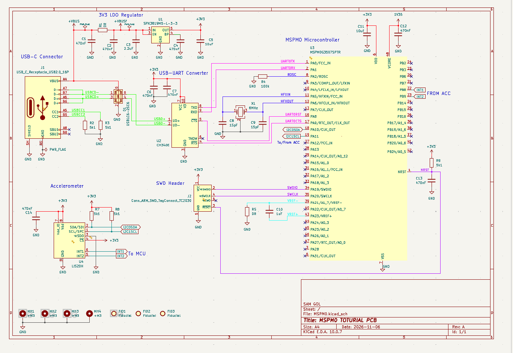

# MSPM0 Development Board

A compact development board built around the **Texas Instruments MSPM0G3507** Arm Cortex-M0+ microcontroller, designed in **KiCad**. The board includes USB-to-UART communication, an I2C accelerometer, and a standard SWD header for programming and debugging.

## Features

- **MCU:** TI MSPM0G3507 (LQFP-48), Arm Cortex-M0+
- **USB-C connector** with ESD protection
- **USB-UART converter:** CH340E
- **3.3 V LDO regulator** powered from USB
- **Accelerometer:** ST LIS2DH (I2C, with interrupt lines INT1/INT2)
- **8 MHz external crystal** (HFXT)
- **SWD header** (TC2030 Tag-Connect) for programming and debugging
- Decoupling and reset circuitry following manufacturer recommendations

## Schematic



## Repository Contents

| File | Description |
|------|-------------|
| `MSPM0.kicad_sch` | Schematic |
| `MSPM0.kicad_pcb` | PCB layout |
| `MSPM0.kicad_pro` | KiCad project file |
| `MSPM0-ToturialSchemSymLib.kicad_sym` | Custom symbol library |
| `sym-lib-table` | Project symbol library table |

## Getting Started

1. Install [KiCad](https://www.kicad.org/) (developed with KiCad 10).
2. Clone this repository:
   ```bash
   git clone https://github.com/SamGolgoun/MSPM0.git
   ```
3. Open `MSPM0.kicad_pro` in KiCad.
4. Make sure the project symbol library is loaded (Preferences → Manage Symbol Libraries → Project Specific Libraries).

## Status

🚧 Work in progress: schematic complete, PCB layout and routing ongoing.

## Acknowledgements

This project was created while following the [Phil's Lab](https://www.youtube.com/@PhilsLab) KiCad hardware design tutorial for the MSPM0. Many thanks for the excellent material.

## License

This project is licensed under the [MIT License](LICENSE).
